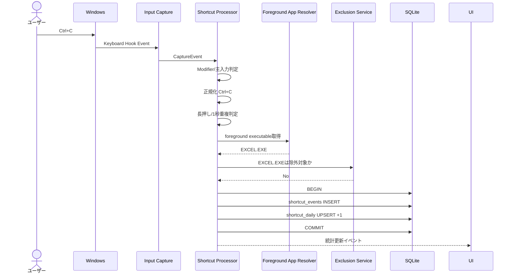
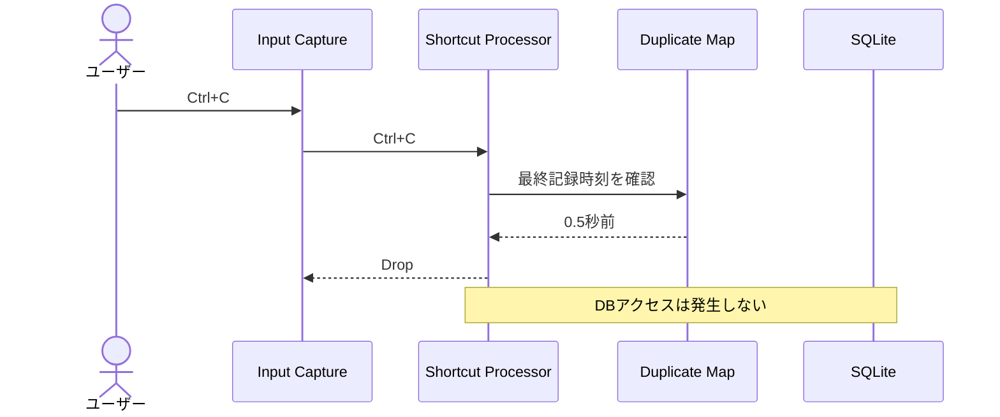
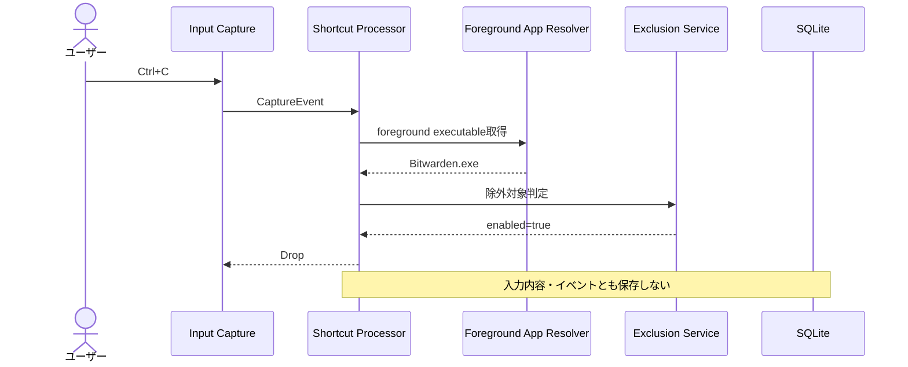
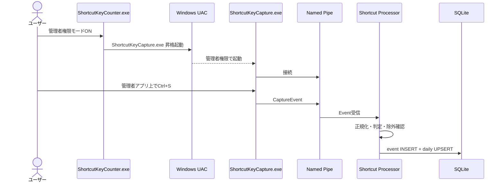
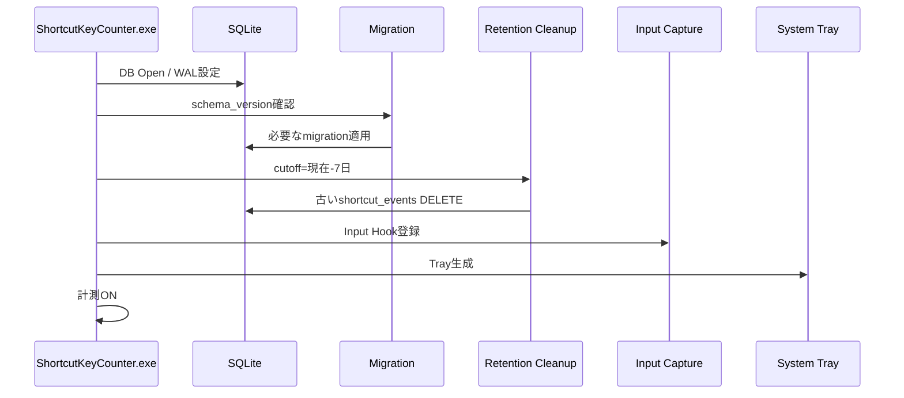
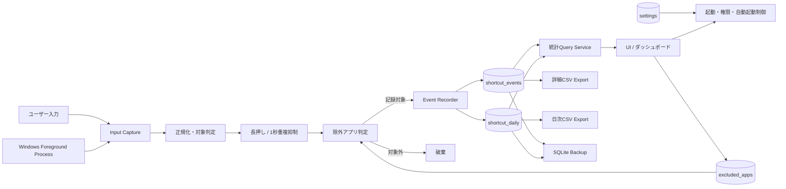
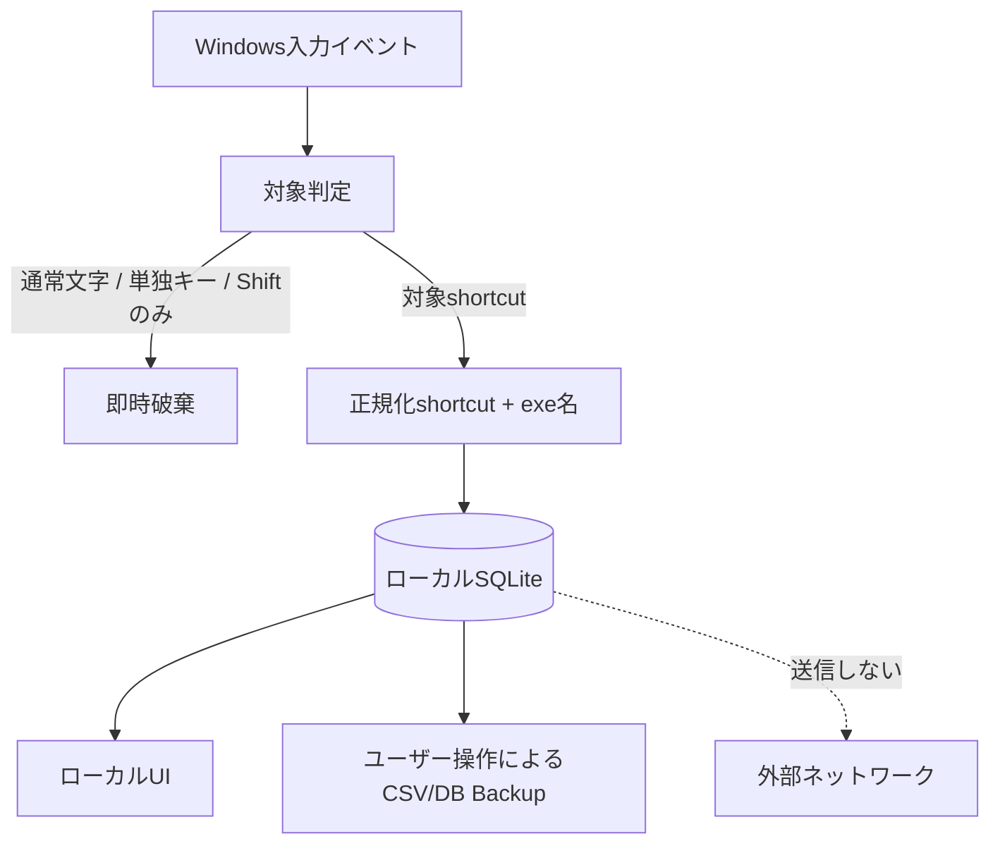

# ショートカットキーカウンター 仕様書

## 1. 文書の位置づけ

本書は「ショートカットキーカウンター」を実装へ落とし込むための要求定義・基本設計・実装計画である。
UI/UX詳細以外の機能仕様は原則として本書を基本とする。

### 1 本計画で仮決定する実装事項

| 項目 | 採用案 | 理由 |
|---|---|---|
| デスクトップ基盤 | Tauri + Rust + HTML/CSS/TypeScript | Windows常駐、低メモリ、Web UI、RustでWin32連携を行いやすい |
| DB | SQLite / WAL | 仕様書の第一候補を採用。読み取りUIと継続書き込みを両立 |
| 一般権限プロセス | `ShortcutKeyCounter.exe` | UI、判定、DB、集計、設定、エクスポートを担当 |
| 昇格Capture | `ShortcutKeyCapture.exe` | 管理者権限アプリ用の入力取得専用プロセス |
| 入力フック | Win32 Low-Level Hook (`WH_KEYBOARD_LL`, `WH_MOUSE_LL`) | グローバル入力監視を低コストで実装可能 |
| アクティブアプリ取得 | Foreground Window → PID → executable name | 保存対象を実行ファイル名のみに限定 |
| IPC | Windows Named Pipe | ローカル限定、双方向不要、権限境界を越えた通信に適する |
| 自動起動 | Windows Startup登録をRust側で抽象化 | ZIP版/インストーラー版双方で共通化しやすい |
| DB保存先 | `%LOCALAPPDATA%\ShortcutKeyCounter\ShortcutKeyCounter.db` | インストーラー/ZIPでデータ場所を共通化し、アプリ更新・展開先から分離 |
| アプリログ | `%LOCALAPPDATA%\ShortcutKeyCounter\logs\` | DBとは分離。日次ローテーション、短期保持 |
| DBマイグレーション | `schema_meta.schema_version` + 順次SQL migration | 仕様書に沿い、ダウングレードは非対応 |
| インストーラー | Inno Setupを第一候補 | 無償、アンインストール時のDB保持/削除選択を実装しやすい |
| UIモック | 外部ライブラリなしの単一HTML | オフラインで確認しやすく、Tauriへ移植しやすい |

> 注: 上表は仕様書の「未決事項」に対する実装提案であり、仕様書そのものによる確定事項ではない。

---

# 1. 実装対象の整理

## 1 コア要件

- Ctrl / Alt / Win のいずれかを含むショートカットのみ記録する。
- Shiftは単独Modifierとしては対象外だが、Ctrl / Alt / Winとの組み合わせでは記録する。
- 左右Modifierを統合し、`Ctrl → Alt → Win → Shift → 主入力` の順に正規化する。
- 対象マウス操作は左クリック、右クリック、ホイール上、ホイール下。
- キーリピートによる重複を1押下1回に抑制する。
- 同一正規化ショートカットの1秒以内再入力を抑制する。
- 入力時のアクティブアプリは実行ファイル名だけを保存する。
- 除外アプリ上の入力は保存しない。
- 詳細イベントは直近7日、日次集計は無期限保持する。
- イベントと日次集計は同一トランザクションで更新する。
- すべての統計・履歴はローカル保存し、外部送信しない。

## 2 UIから扱う機能

- 計測ON/OFF
- ダッシュボード
- ランキング
- 日別推移
- アプリ別集計
- ショートカット別詳細
- 除外アプリ管理
- Windows自動起動設定
- 管理者権限Capture設定
- CSVエクスポート
- DBバックアップ
- 全データ削除

---

# 2. 推奨アーキテクチャ

```text
┌───────────────────────────────────────────────────────────┐
│ ShortcutKeyCounter.exe  [通常ユーザー権限]                  │
│                                                           │
│  ┌───────────────┐      ┌──────────────────────────────┐ │
│  │ Tauri / UI    │◀────▶│ Application Services         │ │
│  └───────────────┘      │ - Capture Coordinator        │ │
│                         │ - Shortcut Normalizer        │ │
│  ┌───────────────┐      │ - Eligibility Filter        │ │
│  │ Input Capture │─────▶│ - Duplicate Suppressor      │ │
│  │ (通常権限)    │      │ - Exclusion Filter          │ │
│  └───────────────┘      │ - Event Recorder            │ │
│                         │ - Export / Backup            │ │
│                         └──────────────┬───────────────┘ │
│                                        │                 │
│                                        ▼                 │
│                              ┌──────────────────┐         │
│                              │ SQLite / WAL     │         │
│                              └──────────────────┘         │
└───────────────────────────────────────────────────────────┘
                  ▲
                  │ Windows Named Pipe
                  │
┌─────────────────┴───────────────────────────┐
│ ShortcutKeyCapture.exe [必要時のみ管理者権限] │
│ - Keyboard Hook                            │
│ - Mouse Hook                               │
│ - Foreground executable resolution         │
│ - Raw event IPC送信のみ                    │
└─────────────────────────────────────────────┘
```

## 1 プロセス責務

### ShortcutKeyCounter.exe

- UI
- 通常権限での入力フック
- 入力イベント正規化
- 記録対象判定
- 1秒重複判定
- 除外アプリ判定
- SQLite writer
- 統計照会
- CSV出力
- DBバックアップ
- 設定管理
- ログ管理
- 自動起動管理
- 昇格Captureの起動・停止・監視

### ShortcutKeyCapture.exe

- 管理者権限が必要な場合のみ起動
- キーボード/マウスHook
- Foreground executable name の解決
- IPCへのRaw Event送信
- SQLiteには一切アクセスしない
- UIを持たない

---

# 3. モジュール構成案

```text
src/
├─ app/
│  ├─ lifecycle.rs
│  ├─ tray.rs
│  └─ commands.rs
├─ capture/
│  ├─ keyboard_hook.rs
│  ├─ mouse_hook.rs
│  ├─ key_state.rs
│  ├─ foreground_app.rs
│  └─ capture_event.rs
├─ shortcut/
│  ├─ normalizer.rs
│  ├─ eligibility.rs
│  ├─ repeat_guard.rs
│  └─ duplicate_guard.rs
├─ exclusion/
│  ├─ service.rs
│  └─ defaults.rs
├─ storage/
│  ├─ db.rs
│  ├─ migrations.rs
│  ├─ event_repository.rs
│  ├─ daily_repository.rs
│  ├─ settings_repository.rs
│  └─ excluded_apps_repository.rs
├─ statistics/
│  ├─ dashboard.rs
│  ├─ ranking.rs
│  ├─ application_stats.rs
│  └─ shortcut_detail.rs
├─ export/
│  ├─ csv.rs
│  ├─ db_backup.rs
│  └─ downloads_folder.rs
├─ system/
│  ├─ autostart.rs
│  ├─ power_resume.rs
│  ├─ elevation.rs
│  └─ ipc.rs
└─ diagnostics/
   ├─ logger.rs
   └─ health.rs

capture-helper/
├─ main.rs
├─ keyboard_hook.rs
├─ mouse_hook.rs
├─ foreground_app.rs
└─ named_pipe_client.rs

ui/
├─ index.html
├─ styles/
├─ components/
├─ pages/
└─ services/
```

---

# 4. データモデル詳細

## 1 `shortcut_events`

| 列 | 型案 | 制約 | 説明 |
|---|---|---|---|
| `id` | INTEGER | PK AUTOINCREMENT | イベントID |
| `occurred_at` | TEXT | NOT NULL | ローカル日時 `YYYY-MM-DD HH:MM:SS.sss` |
| `shortcut` | TEXT | NOT NULL | 正規化済みショートカット |
| `application` | TEXT | NOT NULL | 実行ファイル名 |

推奨Index:
- `idx_events_occurred_at(occurred_at)`
- `idx_events_shortcut_occurred(shortcut, occurred_at)`
- `idx_events_application_occurred(application, occurred_at)`

## 2 `shortcut_daily`

| 列 | 型案 | 制約 | 説明 |
|---|---|---|---|
| `date` | TEXT | NOT NULL | ローカル日付 |
| `shortcut` | TEXT | NOT NULL | 正規化済みショートカット |
| `application` | TEXT | NOT NULL | 実行ファイル名 |
| `count` | INTEGER | NOT NULL | 日次回数 |

制約:
- `UNIQUE(date, shortcut, application)`

## 3 `excluded_apps`

| 列 | 型案 | 制約 | 説明 |
|---|---|---|---|
| `id` | INTEGER | PK AUTOINCREMENT | ID |
| `executable_name` | TEXT | NOT NULL | exe名 |
| `source` | TEXT | NOT NULL | `default` / `user` |
| `enabled` | INTEGER | NOT NULL | 1=除外有効、0=解除 |

推奨制約:
- `UNIQUE(executable_name COLLATE NOCASE)`

## 4 `settings`

| 列 | 型案 | 制約 | 説明 |
|---|---|---|---|
| `key` | TEXT | PK | 設定名 |
| `value` | TEXT | NOT NULL | 設定値 |

初期値:
- `auto_start = true`
- `capture_elevated = false`

計測ON/OFFは保存しない。

## 5 `schema_meta`

| 列 | 型案 | 制約 | 説明 |
|---|---|---|---|
| `schema_version` | INTEGER | NOT NULL | DBスキーマVersion |

---

# 5. サンプルデータ表

## 1 shortcut_events

| id | occurred_at | shortcut | application |
|---:|---|---|---|
| 1001 | 2026-08-15 09:14:21.152 | Ctrl+C | EXCEL.EXE |
| 1002 | 2026-08-15 09:14:27.824 | Ctrl+V | EXCEL.EXE |
| 1003 | 2026-08-15 09:15:02.103 | Alt+Tab | EXCEL.EXE |
| 1004 | 2026-08-15 09:16:18.412 | Ctrl+S | Code.exe |
| 1005 | 2026-08-15 09:17:41.001 | Ctrl+Shift+P | Code.exe |
| 1006 | 2026-08-15 09:18:02.504 | Win+E | explorer.exe |
| 1007 | 2026-08-15 09:19:15.910 | Ctrl+L | msedge.exe |
| 1008 | 2026-08-15 09:19:20.028 | Ctrl+T | msedge.exe |
| 1009 | 2026-08-15 09:20:44.211 | Ctrl+MouseLeft | EXCEL.EXE |
| 1010 | 2026-08-15 09:21:10.778 | Ctrl+WheelUp | msedge.exe |
| 1011 | 2026-08-15 09:22:35.660 | Win+Shift+S | explorer.exe |
| 1012 | 2026-08-15 09:24:05.023 | Ctrl+Alt+T | WindowsTerminal.exe |

## 2 shortcut_daily

| date | shortcut | application | count |
|---|---|---|---:|
| 2026-08-15 | Ctrl+C | EXCEL.EXE | 183 |
| 2026-08-15 | Ctrl+V | EXCEL.EXE | 142 |
| 2026-08-15 | Ctrl+S | Code.exe | 94 |
| 2026-08-15 | Ctrl+Shift+P | Code.exe | 61 |
| 2026-08-15 | Alt+Tab | EXCEL.EXE | 57 |
| 2026-08-15 | Ctrl+L | msedge.exe | 46 |
| 2026-08-15 | Ctrl+T | msedge.exe | 38 |
| 2026-08-15 | Win+E | explorer.exe | 23 |
| 2026-08-15 | Win+Shift+S | explorer.exe | 12 |
| 2026-08-15 | Ctrl+MouseLeft | EXCEL.EXE | 11 |
| 2026-08-15 | Ctrl+WheelUp | msedge.exe | 9 |
| 2026-08-15 | Ctrl+Alt+T | WindowsTerminal.exe | 5 |

## 3 excluded_apps

| id | executable_name | source | enabled |
|---:|---|---|---:|
| 1 | KeePass.exe | default | 1 |
| 2 | KeePassXC.exe | default | 1 |
| 3 | Bitwarden.exe | default | 1 |
| 4 | Enpass.exe | default | 1 |
| 5 | 1Password.exe | default | 1 |
| 6 | NordPass.exe | default | 1 |
| 7 | ProtonPass.exe | default | 1 |
| 8 | KeeperPasswordManager.exe | default | 1 |
| 9 | RoboForm.exe | default | 1 |
| 10 | StickyPassword.exe | default | 1 |
| 11 | PasswordSafe.exe | default | 1 |
| 12 | SecureMemo.exe | user | 1 |

## 4 settings

| key | value |
|---|---|
| auto_start | true |
| capture_elevated | false |

## 5 schema_meta

| schema_version |
|---:|
| 1 |

## 6 1秒重複抑制のテスト用サンプル

| 時刻 | 入力 | アプリ | 判定 | 理由 |
|---|---|---|---|---|
| 10:00:00.000 | Ctrl+C | EXCEL.EXE | 記録 | 初回 |
| 10:00:00.500 | Ctrl+C | msedge.exe | 非記録 | 同一正規化shortcutの前回記録から1秒以内 |
| 10:00:00.600 | Ctrl+V | EXCEL.EXE | 記録 | 異なるshortcut |
| 10:00:01.200 | Ctrl+C | EXCEL.EXE | 記録 | 1秒経過 |

---

# 6. 入力イベント内部モデル

Capture層からアプリ層へは、生文字列ではなく構造化イベントだけを渡す。

```text
CaptureEvent
- event_type: KeyDown | KeyUp | MouseDown | MouseWheel
- virtual_key / mouse_action
- ctrl: bool
- alt: bool
- win: bool
- shift: bool
- is_repeat: bool
- occurred_at_local
- foreground_executable
```

重要:
- 通常文字列は生成しない。
- ウィンドウタイトルを取得しない。
- URLやドキュメント名を取得しない。
- 保存対象とならない入力はDB層へ渡さない。

---

# 7. 処理ルール実装順序

入力1件ごとに以下の順序で処理する。

1. Hookからイベント取得
2. 現在のModifier状態を確定
3. キーリピート/同一押下中イベントを除外
4. 記録対象となる主入力か判定
5. Ctrl / Alt / Win が最低1つ含まれるか判定
6. 左右Modifierを統合
7. Modifier順序を正規化
8. 正規化文字列を生成
9. 同一shortcutの1秒以内重複をメモリで判定
10. foreground executable を取得
11. 除外アプリ判定
12. SQLite transaction開始
13. `shortcut_events` INSERT
14. `shortcut_daily` UPSERT (`count = count + 1`)
15. COMMIT
16. 最終記録時刻Mapを更新
17. UIへ必要な場合だけ統計更新通知

### 1 重複抑制Map

```text
HashMap<NormalizedShortcut, Instant>
```

- アプリをまたいで共通。
- 保存成功後に最終記録時刻を更新する。
- DB障害で保存失敗した場合は、記録済みとして扱わない。

---

# 8. シーケンス図

## 1 通常のショートカット記録



## 2 1秒以内重複入力



## 3 除外アプリでの入力



## 4 管理者権限アプリからの取得



## 5 アプリ起動時



---

# 9. データフロー図

## 1 Level 1



## 2 プライバシー境界



---

# 10. DB書き込み仕様

## 1 1イベントのTransaction

疑似SQL:

```sql
BEGIN IMMEDIATE;

INSERT INTO shortcut_events (
    occurred_at,
    shortcut,
    application
) VALUES (?, ?, ?);

INSERT INTO shortcut_daily (
    date,
    shortcut,
    application,
    count
) VALUES (?, ?, ?, 1)
ON CONFLICT(date, shortcut, application)
DO UPDATE SET count = count + 1;

COMMIT;
```

### エラー時

- TransactionはROLLBACK。
- Duplicate Mapの最終記録時刻は更新しない。
- HookスレッドをDB I/Oでブロックしない。
- Capture → Recorder間に小さなbounded queueを置き、DB writerを単一化する。

---

# 11. スレッド・非同期設計

```text
Main/UI Thread
  └─ Tauri UI / Tray / commands

Hook Thread
  └─ Win32 Hook callback
       └─ 軽量CaptureEvent生成
            └─ non-blocking queue送信

Processor Thread
  └─ 正規化 / 対象判定 / duplicate / exclusion
       └─ DB Writer Queue

DB Writer Thread [single writer]
  └─ shortcut_events + shortcut_daily transaction

IPC Reader Thread [elevated mode only]
  └─ Named Pipe → Processor Queue
```

### Hook callback内で禁止する処理

- SQLiteアクセス
- CSV出力
- 重い文字列処理
- UI更新
- ファイルI/O
- 長時間Lock

---

# 12. アプリ起動・終了・復帰

## 1 起動

1. 単一起動Mutex取得
2. ログ初期化
3. DBディレクトリ作成
4. SQLite open
5. WAL設定
6. Migration
7. 7日超の詳細イベント削除
8. settings読込
9. excluded_apps読込
10. 計測状態を強制ON
11. Capture起動
12. capture_elevated=trueの場合は昇格Capture起動
13. Tray起動
14. UI準備

## 2 スリープ/休止復帰

1. Power resume event受信
2. Hookの生存確認
3. Hook解除
4. Hook再登録
5. elevated CaptureとのNamed Pipe再接続
6. 計測ONを保証
7. 失敗時はログ記録 + Tray/UIに状態表示

## 3 終了

1. Hook解除
2. Capture helper停止
3. Queue drain
4. SQLite commit確認
5. DB close
6. ログflush

---

# 13. CSVエクスポート実装

## 日次集計

```text
ShortcutKeyCounter_daily_YYYYMMDD_HHMMSS.csv
```

列:

```csv
date,shortcut,application,count
```

## 詳細イベント

```text
ShortcutKeyCounter_events_YYYYMMDD_HHMMSS.csv
```

列:

```csv
timestamp,shortcut,application
```

### 実装注意

- Windows Known Folder APIでDownloadsを解決。
- 解決不能時のみ保存先ダイアログ。
- UTF-8 BOM付きを第一候補とする（Excelでの日本語互換性を考慮）。
- CSV生成中もCaptureを止めない。
- 大量データ時は全件をメモリへ読み込まずstreaming出力する。

---

# 14. DBバックアップ

- SQLite Backup APIを使用する。
- 稼働中DBファイルをOSコピーしない。
- 出力先はDownloads。
- ファイル名:

```text
ShortcutKeyCounter_DB_YYYYMMDD_HHMMSS.db
```

バックアップ中も通常計測を継続する。

---

# 15. 全データ削除

実装案:

```sql
BEGIN IMMEDIATE;
DELETE FROM shortcut_events;
DELETE FROM shortcut_daily;
COMMIT;
```

UI設計上は設定と除外アプリは保持する案を推奨する。
理由:
- 仕様書上の全削除対象として明示されているのは詳細イベントと日次集計。
- 除外アプリまで初期化するとプライバシー設定が意図せず解除される可能性がある。

将来「設定も初期化」を追加する場合は別操作とする。

---

# 16. エラー・復旧方針

| 障害 | 方針 |
|---|---|
| DB open失敗 | Captureを開始せずエラー表示 |
| Event INSERT失敗 | rollback、イベントは未記録としてログ |
| Hook登録失敗 | 計測異常状態を明示 |
| Named Pipe切断 | helper再接続を試行、通常権限Captureは継続 |
| elevated helper起動拒否 | capture_elevated設定は維持しつつ今回起動は通常権限にfallback |
| Downloads解決失敗 | 保存先選択ダイアログ |
| CSV作成失敗 | DBは変更しない |
| Backup失敗 | 元DBは変更しない |
| Migration失敗 | DB writerを開始しない。旧DBを保全 |
| DB破損疑い | 自動初期化しない。復旧案内とDBバックアップ導線を提示 |

---

# 17. ログ方針

アプリケーション診断ログには以下だけを記録する。

- 起動/終了
- Version
- DB open / migration結果
- Hook登録/解除
- sleep/resume
- elevated helper起動/停止
- IPC接続/切断
- export/backup成否
- エラーコード

**記録しない:**
- 通常文字入力
- ショートカットイベントの全履歴
- window title
- URL
- document名

推奨保持:
- 7〜14日
- 1ファイル数MB上限でrotation

---

# 18. テスト計画

## 1 Unit Test

### Shortcut Normalizer

- Left Ctrl / Right Ctrl → Ctrl
- modifier押下順を変えても同じ結果
- Shiftが最後に来る
- mouse actionの表記

### Eligibility

記録する:
- Ctrl+C
- Ctrl+Shift+C
- Alt+Tab
- Win+E
- Ctrl+MouseLeft

記録しない:
- A
- F5
- Shift+A
- Shift+↑
- Ctrl単独
- Ctrl+Alt（主入力なし）
- MouseLeft単独

### Repeat Guard

- KeyDown repeatを1件にまとめる
- KeyUp後の次回KeyDownは別イベント

### Duplicate Guard

- 同じshortcut 0.5秒 → reject
- 同じshortcut 1.2秒 → accept
- 別shortcut 0.3秒 → accept
- アプリが異なっても同shortcut 0.5秒 → reject

### Exclusion

- case-insensitive exe比較
- enabled=falseは記録対象
- 未インストールexeでも設定保持

## 2 Integration Test

- event INSERT と daily UPSERTの原子性
- rollback時にdailyだけ増えないこと
- 7日保持削除
- WAL同時read/write
- CSV内容
- DB Backup整合性
- migration
- settings persistence
- 計測ON/OFF非永続化

## 3 Windows実機Test

- Excel
- Edge
- VS Code
- Explorer
- Windows Terminal
- RDP Client
- 管理者権限で起動したNotepad等
- Sleep → Resume
- Hibernate → Resume
- Lock → Unlock
- multi-monitor
- 長時間稼働

### Windows側制約確認

- Ctrl+Alt+Delete
- Win+Shift+S
- PrintScreen
- Secure Desktop

これらは「取得できないことがある」前提で、取得率100%を合格条件にしない。

## 4 Performance Test

目標値は初回計測後に確定するが、最低限以下を監視する。

- 待機中CPU
- 連続入力時CPU
- private memory
- Hook callback latency
- queue length
- DB transaction latency
- 24h / 72h連続稼働

---

# 19. 実装フェーズ

## Phase 0: Repository / Build基盤

成果物:
- Rust/Tauri workspace
- `ShortcutKeyCounter.exe` skeleton
- `ShortcutKeyCapture.exe` skeleton
- CI build
- lint / formatter / test基盤

完了条件:
- 2プロセスをWindows上でbuild・起動可能

## Phase 1: SQLite基盤

実装:
- DB path
- schema v1
- migration framework
- WAL
- repositories
- transaction
- seed default excluded apps

完了条件:
- unit/integration testでCRUDとtransactionが通る

## Phase 2: 通常権限Input Capture

実装:
- keyboard hook
- mouse hook
- modifier state
- foreground exe
- hook queue

完了条件:
- console/debug UI上で対象候補イベントを確認可能

## Phase 3: Shortcut判定Engine

実装:
- eligibility
- normalizer
- long-press guard
- 1sec duplicate map
- exclusion

完了条件:
- 仕様書の入力例を自動testで網羅

## Phase 4: Event Recorder

実装:
- single DB writer
- event INSERT
- daily UPSERT
- failure rollback

完了条件:
- 実入力からDBまで一貫記録

## Phase 5: Lifecycle / Tray

実装:
- 計測ON/OFF
- startup default ON
- Windows auto start
- tray
- sleep/resume
- lock/unlock耐性
- 7日cleanup

完了条件:
- 再起動・復帰後も仕様通り計測再開

## Phase 6: Elevated Capture

実装:
- UAC起動
- named pipe
- helper lifecycle
- IPC validation
- disconnect recovery

完了条件:
- 管理者権限アプリ上の取得をhelper経由で確認

## Phase 7: Statistics API

実装:
- dashboard summary
- ranking
- date trend
- application aggregation
- shortcut detail

完了条件:
- UIが必要とするqueryをDB repository経由で返せる

## Phase 8: UI本実装

基準:
- 本回答に添付するHTMLモック

実装:
- dashboard
- rankings
- app stats
- shortcut details
- settings
- excluded apps
- export/backup/delete
- capture state

完了条件:
- mockと同等の導線をTauri UI上で再現

## Phase 9: Export / Backup / Delete

実装:
- Downloads known folder
- CSV
- SQLite Backup API
- full delete

完了条件:
- 仕様ファイル名・列定義で出力可能

## Phase 10: Installer / ZIP

実装:
- Inno Setup
- ZIP package
- common data path
- autostart
- uninstall DB保持/削除選択

完了条件:
- clean Windows VMでinstall/update/uninstallを確認

## Phase 11: Hardening / Release

実装:
- crash handling
- structured logging
- DB corruption handling
- performance tuning
- security review
- code signing手順
- release checklist

完了条件:
- 長時間稼働、復帰、異常系、upgradeを含む受入Test通過

---

# 20. 実装優先順位

最短で「使えるコア」を作る順番は以下。

```text
DB
↓
Input Hook
↓
Normalizer / Filter / Duplicate
↓
Event Recorder
↓
Tray + ON/OFF
↓
Sleep Resume
↓
Statistics
↓
UI
↓
Elevated Capture
↓
Export / Backup
↓
Installer / ZIP
↓
Hardening
```

UIより先に、**Hook → 判定 → DB** の縦切りを完成させる。
これにより本アプリ最大の技術リスクであるWindowsグローバル入力取得と性能・重複判定を早期に検証できる。

---

# 21. 最初に作る検証用Prototype

本番UIに着手する前に、以下だけの内部Prototypeを作る。

```text
[Capture ON]
2026-08-15 18:21:01.220 | Ctrl+C       | EXCEL.EXE       | SAVED
2026-08-15 18:21:01.702 | Ctrl+C       | EXCEL.EXE       | DUPLICATE DROP
2026-08-15 18:21:02.101 | Ctrl+V       | EXCEL.EXE       | SAVED
2026-08-15 18:21:03.402 | Shift+A      | Code.exe        | NOT TARGET
2026-08-15 18:21:04.012 | Ctrl+C       | Bitwarden.exe   | EXCLUDED
```

このPrototypeで先に検証するもの:

- Windows Hookの安定性
- Modifier状態
- Key repeat
- foreground exe解決
- 1秒抑制
- excluded app
- DB write latency
- sleep/resume

---

# 22. UIモックから本実装へ接続するAPI案

Tauri commandの例:

```text
get_dashboard_summary(range)
get_shortcut_ranking(range, application?)
get_daily_trend(range, shortcut?, application?)
get_application_ranking(range)
get_shortcut_detail(shortcut, range)
get_excluded_apps()
add_excluded_app(executable_name)
set_excluded_app_enabled(id, enabled)
remove_user_excluded_app(id)
get_settings()
set_auto_start(enabled)
set_capture_elevated(enabled)
set_capture_enabled(enabled)   // 非永続
export_daily_csv()
export_events_csv()
backup_database()
delete_all_statistics()
```

UIはSQLiteへ直接アクセスせず、必ずRust command経由とする。

---

# 23. 受入基準

## 必須機能

- 対象shortcutだけ記録する
- 通常文字入力を保存しない
- shortcut正規化が仕様通り
- key repeat抑制
- 1秒重複抑制
- foreground exeだけ保存
- excluded appが機能
- event/daily整合性
- 7日詳細保持
- daily無期限保持
- 起動時capture ON
- sleep/hibernate復帰後capture ON
- CSV出力
- DB backup
- 全データ削除
- auto start
- elevated mode
- installer / ZIP
- アンインストール時DB保持選択

## 品質

- 常駐中に通常操作へ体感遅延を与えない
- DB writerは単一化
- 外部通信なし
- UIから通常入力内容を復元できない
- 異常終了後もDBを再openできる

---

# 24. HTML UIモックとの対応

添付の `shortcut_key_counter_ui_mock.html` では以下を確認できる。

- ダッシュボード
- 今日/7日/30日/全期間の期間切替イメージ
- Shortcut Ranking
- Daily Activity
- Application Ranking
- Shortcut Detail
- Excluded Apps管理
- Settings
- Capture ON/OFF
- Windows auto start
- Elevated capture
- CSV export
- DB backup
- 全データ削除確認Dialog

モックは外部CDNを利用せず、1ファイルで完結する。
